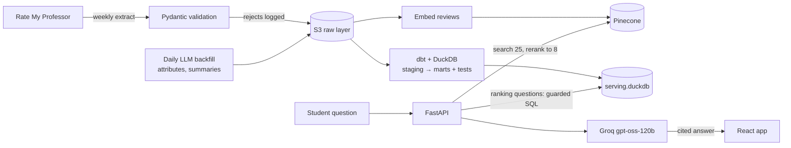

# UCSD ProfAI

A data pipeline and retrieval-augmented generation (RAG) app that lets UCSD students ask plain-English questions
about professors and get answers cited from 21,649 real Rate My Professor reviews.

**Live:** [profai.ameygupta.com](https://profai.ameygupta.com) · [API docs](https://api.profai.ameygupta.com/docs)

## Highlights

- **Weekly ELT pipeline:** reviews for 500 professors are extracted, validated and landed in S3, then modeled in
  dbt + DuckDB (17 models, 41 data tests). A failed test stops the run before anything is published.
- **Measured retrieval:** a cross-encoder reranker raised recall@10 from 0.76 to **0.94** and MRR from 0.75 to
  **0.88** on a hand-labeled 50-question set.
- **Text-to-SQL with guardrails:** ranking questions ("easiest CSE professor") are answered from the ratings
  tables. LLM-written SQL runs only if DuckDB's own parser confirms a single `SELECT` on allow-listed tables.
- **LLM extraction as a data step:** exam style, curve and workload are pulled from free-text reviews into
  schema-validated fields, incrementally and under a daily token budget.
- **Tested and automated:** 74 pytest tests, CI on every PR (lint, tests, dbt build on fixtures, dependency audit),
  and a daily freshness check on the published data.

## Architecture



1. **Extract:** every week, GitHub Actions pulls new reviews from Rate My Professor's GraphQL API. Each record is
   validated with Pydantic, and bad records are written to a rejects table with a reason instead of being dropped.
2. **Transform:** dbt models the raw layer into staging, intermediate and mart tables in DuckDB, with data tests
   for nulls, uniqueness, accepted values, freshness and instructor matching.
3. **Embed:** reviews are embedded with `multilingual-e5-large` (1024 dims) into Pinecone.
4. **Retrieve:** a question finds its 25 closest reviews, and `bge-reranker-v2-m3` keeps the best 8.
5. **Generate:** `gpt-oss-120b` on Groq answers from those reviews plus any SQL results, citing each review it uses.

## Results

Measured with `python -m eval.run_eval` against hand-labeled question sets in [eval/](eval/).

| Metric | Result |
|---|---|
| Retrieval recall@10 (50 questions) | 0.76 dense only → **0.94 with reranking** |
| Retrieval MRR (50 questions) | 0.75 dense only → **0.88 with reranking** |
| Retrieval latency, p95 | **800 ms** with reranking |
| LLM answer latency, p50 / p95 | **0.76 s / 0.99 s** (9-question run) |
| Text-to-SQL, 19 ranking questions | same top pick as the reference SQL **84%** of the time, 0 failed queries |

Answer groundedness (does every claim come from the cited reviews) is being measured next. Full retrieval and SQL
numbers are in [eval/results.md](eval/results.md).

## Design Decisions

- **S3 raw layer, then dbt.** Raw data is kept as extracted, so models can be rebuilt or fixed without
  re-scraping.
- **GitHub Actions over Airflow.** Three linear jobs on a few MB of data don't need a scheduler cluster. The
  reasoning, and what would change the decision, is in [ADR 0003](docs/adr/0003-github-actions-over-airflow.md).
- **LLM output is untrusted input.** Generated SQL is parsed and allow-listed before it runs, on a read-only
  connection with a timeout. Extracted fields must pass a Pydantic schema or they are rejected.
- **Evaluate before claiming.** Every retrieval change is scored against the same labeled set, and the answer eval
  calls the same prompt-building code as the live API so it measures what users actually get.

## Features

- Ask questions about any UCSD professor, optionally filtered by department, with cited answers
- Search 500 professors and every reviewed class by rating, difficulty, grades and class style
- Compare up to three professors side by side
- Rating cards shown inline when an answer names a professor

## Tech Stack

| Layer | Technology |
|---|---|
| Pipeline | Python, Pydantic, AWS S3, dbt + DuckDB, GitHub Actions |
| Retrieval | Pinecone (multilingual-e5-large, bge-reranker-v2-m3) |
| LLM | Groq (openai/gpt-oss-120b) |
| Backend | FastAPI |
| Frontend | React (Vite) |
| Hosting | Render (API), Vercel (frontend) |

## Local Setup

### Prerequisites
- Python 3.12
- Node.js
- A Pinecone account and index named `rmp-rag` (1024 dims, cosine metric)
- A Groq API key

### Backend
```bash
cd rmp-rag
python -m venv .venv
source .venv/bin/activate
pip install -r requirements-dev.txt
```

Create a `.env` file in the root:
```
GROQ_API_KEY=your_groq_api_key
PINECONE_API_KEY=your_pinecone_api_key
PINECONE_INDEX=rmp-rag
```

Build the data the API reads (`data/serving.duckdb`; the first run scrapes every professor and takes a while):
```bash
python -m pipeline.run --skip-embed
```

Start the API:
```bash
uvicorn api.main:app --reload
```

### Frontend
```bash
cd frontend
npm install
npm run dev
```

Create a `.env` file in `frontend/`:
```
REACT_APP_API_URL=http://localhost:8000
```

## Project Structure
```
rmp-rag/
├── api/          # FastAPI backend and text-to-SQL router
├── data/         # Local warehouse and serving data (not in git), Pinecone client
├── docs/adr/     # Architecture decision records
├── eval/         # Labeled question sets and the eval harness
├── frontend/     # React (Vite) frontend
├── infra/        # AWS setup (S3, IAM)
├── pipeline/     # Extract, validate, embed, LLM backfill, publish
├── tests/        # pytest suite and synthetic fixtures
└── transform/    # dbt models and data tests
```
